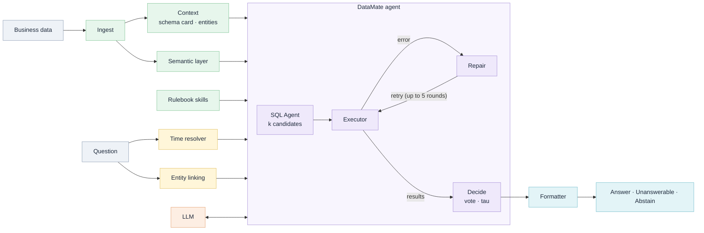

# DataMate — Zalo AI Challenge 2026

Answers colloquial Vietnamese questions ("sp bán dc nhiều nhất tuần rồi") over messy small-business
data (CSV / XLSX / SQLite), fully offline, with a ≤ 15B open model served by vLLM. The metric is
Penalized Accuracy (+1 / 0 / −1), so the system abstains when its executed candidates disagree.

- Task, metric, constraints: [docs/PROJECT.md](docs/PROJECT.md)
- Hypotheses and method: [docs/RESEARCH.md](docs/RESEARCH.md)
- Models used at inference: [docs/MODELS.md](docs/MODELS.md)
- Design: [system design review](docs/notes/2026-10-26/system-design/review.md),
  [data-agent research report](docs/reports/2026-10-26/data-agent-research/report.md)

## How it works



Colors: grey = inputs, green = knowledge about the data and the rules, yellow = understanding the
question, purple = the agent's reasoning, orange = the language model, blue = the final answer.

Built on LangGraph (inference) and LangChain deepagents (synthetic-data teacher, dev only).

## Quick start (dev_free, hosted target model)

```bash
cp .env.example .env        # set LLM_API_KEY (OpenRouter) and DATA_DIR
make install                # uv sync
make test                   # no network, no GPU
uv run python -m scripts.devfree.smoke     # real LLM on a synthetic toy business
make ingest SPLIT=train     # DuckDB + context cache per business
make eval SUBSET=dev200 TOPIC=baseline     # PA report in docs/analysis/<date>/baseline/
```

Batch inference, as the competition runs it: `python -m src --data /data --out /result`.

## dev_constraint / final (local vLLM)

```bash
make vllm                   # serve the target with pinned settings (scripts/vllm.sh)
./scripts/infer.sh          # FINAL_MODE=1: starts vLLM, waits, runs python -m src
make docker-build && make rerun-check     # image runs twice offline, outputs diffed
```

## Synthetic data (deepagents teacher, train only)

```bash
make install-datagen        # uv sync --extra datagen
uv run python -m scripts.datagen.teacher --split train --per-business 30
```

## Layout

```
src/
├── __main__.py            batch entrypoint
├── config.py              settings; FINAL_MODE refuses non-local LLM
├── models/                Question, Answer, SubmissionLine, SchemaCard
├── data/                  duckdb.py (read-only, guarded), layout.py (dataset paths)
├── modules/
│   ├── ingest/            readers + cleaning (headers, merged cells, types)
│   ├── context/           schema card, entity dict + linking
│   ├── semantic/          rulebook views/macros from assets/semantic/*.sql
│   ├── agents/            BaseAgent, SQLAgent (prompts + skills from assets/)
│   ├── decide/            vote, abstain, unanswerable
│   └── llm.py             OpenAI-compatible client (seed, temperature 0)
├── utils/                 format.py (typed answers, rounding), timeparse.py (time expressions →
│                          date ranges), text.py, health.py, logger.py
├── evaluate/              official PA scorer (rulebook §9), used by scripts/eval.py
├── services/ingest/       package → DuckDB + context, cached by content hash
├── services/qa/           graph.py (LangGraph), service.py
├── routes/                /health, /ask (debugging, demo UI)
└── assets/                prompt_templates/, skills/, semantic/
app/                       demo UI (later, on top of /ask)
scripts/                   eval.py, ingest.py, infer.sh, vllm.sh, rerun-check.sh,
                           datagen/ (deepagents teacher), devfree/ (smoke, toy data)
```

## Configuration

See `.env.example`. Main variables:

- app: `APP_NAME`, `APP_VERSION`, `APP_HOST`, `APP_PORT`, `APP_RELOAD`, `LOG_LEVEL`
- LLM: `LLM_BASE_URL`, `LLM_MODEL`, `LLM_API_KEY`, `LLM_EXTRA_BODY`, `FINAL_MODE`
- paths: `DATA_DIR`, `RESULT_DIR`, `WORK_DIR`, `SPLIT`
- policy: `K`, `TAU`, `MAX_REPAIRS`, `TIME_BUDGET_S`

## License

MIT. See [LICENSE](LICENSE).
