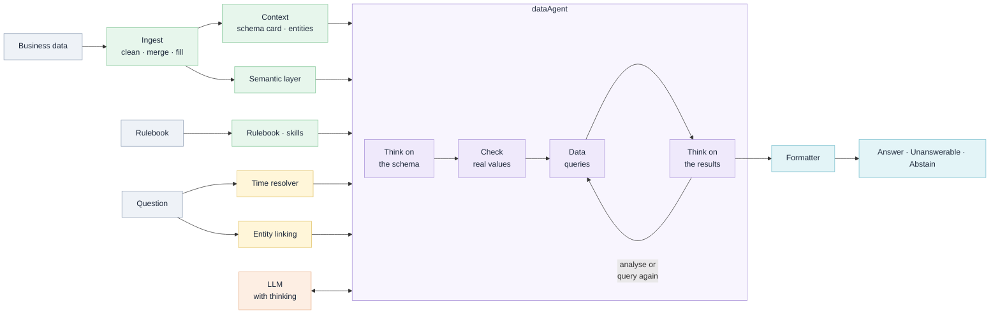

# DataMate — Zalo AI Challenge 2026

Answers colloquial Vietnamese questions ("sp bán dc nhiều nhất tuần rồi") over messy small-business
data (CSV / XLSX / SQLite), fully offline, with a ≤ 15B open model served by vLLM. The metric is
Penalized Accuracy (+1 right / 0 abstain / −1 wrong), so the agent answers only when it is
confident and abstains otherwise.

The agent, **dataAgent**, works like a data analyst: reason over the schema, check real values,
query, reason over the results, answer.

- Task, metric, constraints: [docs/PROJECT.md](docs/PROJECT.md) · challenge rules: [docs/CHALLENGE.md](docs/CHALLENGE.md)
- Hypotheses and method: [docs/RESEARCH.md](docs/RESEARCH.md) · decisions: [docs/NOTES.md](docs/NOTES.md)
- Results of every run: [docs/EXPERIMENTS.md](docs/EXPERIMENTS.md)
- Models used at inference: [docs/MODELS.md](docs/MODELS.md)
- Data errors found and fixed: [docs/notes/2026-10-27/data-errors](docs/notes/2026-10-27/data-errors/notes.md)

## How it works



Colors: grey = inputs, green = knowledge about the data and the rules, yellow = understanding the
question, purple = the agent's reasoning, orange = the language model, blue = the final answer.

The agent's steps:

| Step | What it does |
|---|---|
| Think on the schema | spells out the need, maps each business term to a column or rulebook rule, picks the fields to check |
| Check real values | samples the chosen fields: real values, min / max, rows after the as-of date (code, no LLM) |
| Data queries | 1–3 named SQL queries, run on DuckDB |
| Think on the results | checks the results against the question and the rulebook, then answers, abstains, runs a pandas analysis or one more query |
| Formatter | turns the chosen result into the typed answer (number, percent, date, list, …) |

At most 4 LLM steps per question. The agent may abstain: a wrong answer costs a point, silence
costs nothing. Errors (bad SQL, wrong shape) go back to the next step to be fixed.

Ingest also repairs the data before the agent sees it: VND written as `50.000đ` or `25k`, tables
split into one sheet per month, and exports that write an order's date and status on its first
line only. The `messy-data` skill tells the agent how to spot and fix cases ingest misses.

An older pipeline (`PIPELINE=vote`: k SQL candidates and a vote) is kept for comparison.

## Results (train dev200)

Fixed sample of 200 train questions, hosted `deepseek-flash` (dev only, not the target model).

| Run | PA | right / wrong / abstain |
|---|---|---|
| Baseline: k SQL candidates + vote | 0.09 | 92 / 74 / 34 |
| + rulebook in the prompt | 0.35 | 117 / 47 / 36 |
| dataAgent | 0.43 | 140 / 54 / 6 |
| **dataAgent with thinking** | **0.55** | **122 / 12 / 66** |

With thinking, 91 % of the answers given are right. Full reports: `docs/analysis/<date>/<topic>/`.

## Quick start (dev_free, hosted model)

```bash
cp .env.example .env        # set LLM_BASE_URL, LLM_MODEL, LLM_API_KEY, DATA_DIR
make install                # uv sync
make test                   # no network, no GPU
make ingest SPLIT=train     # DuckDB + context cache per business

# dataAgent with thinking, 8 questions in parallel
PIPELINE=ca ANALYZE_EXTRA_BODY='{"thinking": {"type": "enabled"}}' \
  make eval SUBSET=dev200 TOPIC=my-run WORKERS=8
```

`make eval` writes:
- the report: `docs/analysis/<date>/<topic>/summary.md` (+ `scored.jsonl`, `metrics.json`) and a
  row in `docs/EXPERIMENTS.md`;
- the submission, in the portal's format: `data/results/<date>/<topic>/submission.jsonl`.

Hosted APIs are for train data only. Public and private test run on the local model (below).

## Submission format

One JSON line per question, `.jsonl`, at most 5 MB:

```json
{"id": "q_01235", "type": "number", "answer": 48250000}
{"id": "q_01241", "type": "unanswerable", "reason": "Dữ liệu không có thông tin cần thiết để trả lời câu hỏi"}
{"id": "q_01242", "type": "abstain"}
```

Types: `number`, `percent`, `string`, `date`, `boolean`, `list`, `table`, `unanswerable`,
`abstain`. Each line is written and flushed as soon as it is decided.

## dev_constraint / final (local vLLM)

```bash
make vllm                   # serve the target with pinned settings (scripts/vllm.sh)
./scripts/infer.sh          # FINAL_MODE=1: starts vLLM, waits, runs python -m src
python -m src --data /data --out /result --workers 8    # what the container runs
make docker-build && make rerun-check     # image runs twice offline, outputs diffed
```

For Qwen3 on vLLM, thinking is `ANALYZE_EXTRA_BODY='{"chat_template_kwargs": {"enable_thinking": true}}'`.

## Synthetic data (deepagents teacher, train only)

```bash
make install-datagen        # uv sync --extra datagen
uv run python -m scripts.datagen.teacher --split train --per-business 30
```

## Layout

```
src/
├── __main__.py            batch entrypoint (--workers N threads)
├── config.py              settings; FINAL_MODE refuses a non-local LLM
├── models/                Question, Answer, SubmissionLine, SchemaCard, LLMUsage
├── data/                  duckdb.py (read-only, guarded), layout.py (dataset paths)
├── modules/
│   ├── ingest/            readers + cleaning: headers, merged cells, VND numbers, split tables,
│   │                      grouped exports
│   ├── context/           schema card, entity dict + linking, value sampling
│   ├── semantic/          rulebook views/macros from assets/semantic/*.sql
│   ├── agents/            BaseAgent, SQLAgent (system prompt = template + skills + rulebook)
│   ├── decide/            vote, abstain, unanswerable (vote pipeline)
│   ├── python_exec.py     sandbox for the agent's pandas analysis
│   └── llm.py             OpenAI-compatible client (seed, temperature 0, per-call thinking)
├── services/ingest/       package → DuckDB + context, cached by content hash + INGEST_VERSION
├── services/qa/           ca.py (dataAgent), graph.py (vote pipeline), service.py
├── utils/                 format.py, timeparse.py, text.py, assets.py (prompt / skill files),
│                          health.py, logger.py
├── evaluate/              official PA scorer (rulebook §9), used by scripts/eval.py
├── routes/                /health, /ask (debugging, demo UI)
└── assets/
    ├── prompt_templates/  ca_*.md (dataAgent), sql_*.md, analyze.md, repair.md, rulebook.md
    └── skills/            answer-types, time-expressions, ranking-rules, business-metrics,
                           unanswerable, messy-data
scripts/                   eval.py, ingest.py, infer.sh, vllm.sh, rerun-check.sh,
                           datagen/ (deepagents teacher), devfree/ (smoke, toy data)
notebooks/llm_call.py      one question through the pipeline, for debugging
```

## Configuration

See `.env.example`. Main variables:

- LLM: `LLM_BASE_URL`, `LLM_MODEL`, `LLM_API_KEY`, `LLM_EXTRA_BODY`, `LLM_STREAM`, `FINAL_MODE`
- pipeline: `PIPELINE` (`ca` = dataAgent, or `vote`), `ANALYZE_EXTRA_BODY` (thinking for the reasoning
  steps), `ANALYZE_MAX_TOKENS`, `WORKERS`
- vote pipeline: `K`, `TAU`, `MAX_REPAIRS`, `ANALYZE`
- paths: `DATA_DIR`, `RESULT_DIR`, `WORK_DIR`, `SPLIT`; budget: `TIME_BUDGET_S`
- app: `APP_NAME`, `APP_VERSION`, `APP_HOST`, `APP_PORT`, `APP_RELOAD`, `LOG_LEVEL`

## License

MIT. See [LICENSE](LICENSE).
